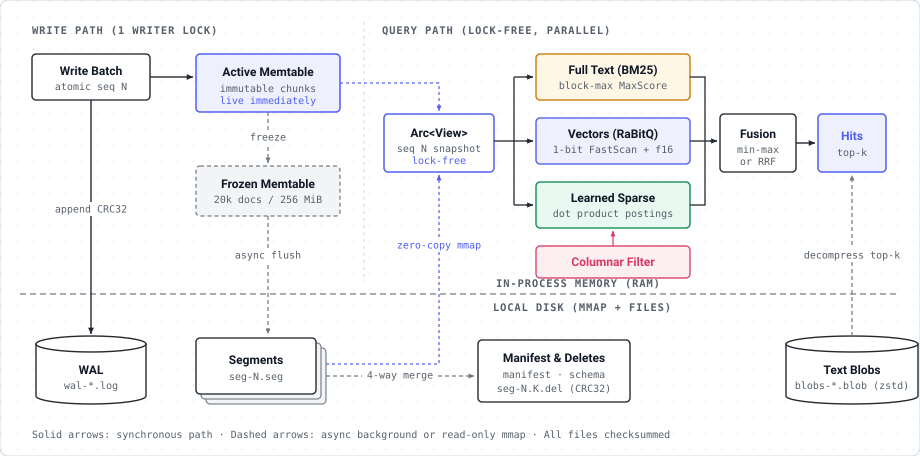
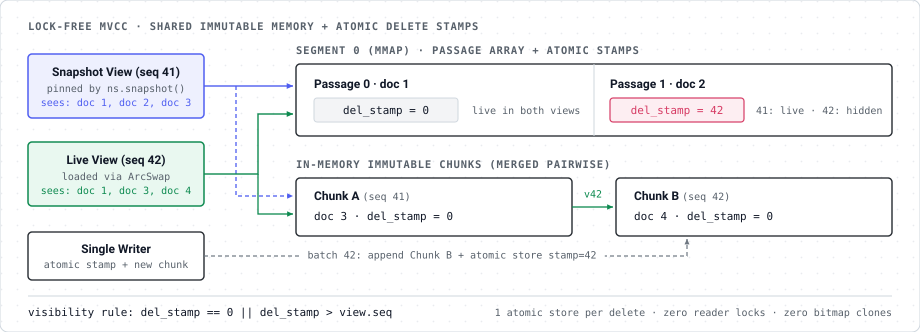
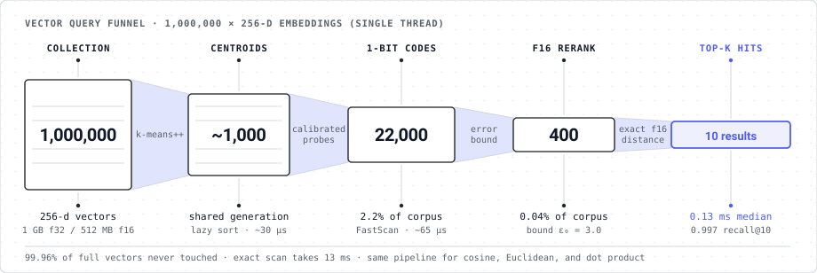

# Hinny Architecture & Design

Hinny is an embedded hybrid search database built for a single machine and a single process, operating directly on memory-mapped local files. It combines BM25 full-text search, 1-bit quantized dense vectors, learned sparse terms, and columnar attribute filters in one storage engine—with immediate read-after-write visibility and lock-free queries.

This document describes how Hinny works today, the invariants it enforces, and the empirical measurements behind its design choices.

---

## Contents

1. [Architecture at a Glance](#1-architecture-at-a-glance)
2. [Storage Engine](#2-storage-engine)
3. [Durability, Recovery & Formats](#3-durability-recovery--formats)
4. [Concurrency & MVCC](#4-concurrency--mvcc)
5. [Mutations, Forks & Replicas](#5-mutations-forks--replicas)
6. [Stored Text](#6-stored-text)
7. [Attributes & Columnar Filtering](#7-attributes--columnar-filtering)
8. [Full-Text Search & Analysis](#8-full-text-search--analysis)
9. [Learned Sparse Fields](#9-learned-sparse-fields)
10. [Vector Search](#10-vector-search)
11. [Hybrid Fusion](#11-hybrid-fusion)
12. [Not Yet](#12-not-yet)

---

## 1. Architecture at a Glance

Every namespace in a Hinny database is an independent log-structured merge-tree (LSM) backed by immutable, memory-mapped files. Writes append to a write-ahead log (WAL) and an in-memory segment; queries read an immutable snapshot (`View`) across segments and memory without locking writers.

  <picture>
    <source media="(prefers-color-scheme: dark)" srcset="docs/diagrams/architecture-dark.svg">
    
  </picture>

### Subsystem Summary

| Subsystem | Mechanism | Key Property |
| :--- | :--- | :--- |
| **Storage** | WAL + immutable mmap segments + size-tiered background merges | Searchable immediately; zero re-indexing on merge |
| **Concurrency** | Single writer lock per process; lock-free MVCC `View` + atomic delete stamps | Readers never block writers; point-in-time `snapshot()` |
| **Stored text** | Key–value separation into ~4 KiB zstd-compressed blob blocks | Merges copy 16-byte references instead of rewriting text |
| **Full text** | BM25, SIMD-BP128 128-doc blocks, Pareto impacts, block-max MaxScore | Global IDF across segments; exact top-k item deduplication |
| **Vectors** | Shared-centroid clusters, 1-bit RaBitQ + FastScan SIMD, `f16` rerank | Self-calibrated probe budgets (~0.997 recall@10); <0.5% reranked |
| **Learned sparse** | Quantized term weights (`0.01` precision) on shared posting lists | Dot-product scoring; combinable with BM25 and dense vectors |
| **Attributes** | Compact integer/dict-encoded columns + 1,024-doc zone maps + SIMD | Native in-search filtering; 32-entry per-segment bitmap cache |
| **Hybrid fusion** | Parallel retrievers, fixed candidate budgets (`200/100/200`), 50/50 blend | Outperforms RRF on BEIR and mailbox benchmarks |

---

## 2. Storage Engine

A namespace is organized as an LSM tree built for local disks and OS page caches.

### Write & Checkpoint Lifecycle

1. **WAL + Memtable:** Every write batch appends one CRC32-checksummed record to the active WAL and inserts an immutable chunk into the active memtable. Once the WAL bytes reach the OS buffer, the write returns: it is immediately searchable and survives a process crash.
2. **Background Flush:** When the active memtable reaches **20,000 passages** or **`flush_bytes` (256 MiB)**, it freezes and flushes on a background thread while new writes continue into a fresh memtable with its own WAL. Queries search both; deletes still apply to the frozen memtable. Its WAL is deleted only after the manifest atomically publishes the new segment.
3. **Backpressure:** If the next memtable fills to 2× its limit before the frozen flush finishes, writers pause briefly so memory remains bounded (~4× `flush_bytes` worst case). Calling `flush()` forces a synchronous checkpoint and waits.
4. **Size-Tiered Merges:** Background workers merge at low priority whenever 4 segments occupy the same size tier, or when deletions leave a segment mostly dead. Merges combine posting lists, attribute columns, and vector lists directly without re-tokenizing or re-embedding text. If flushes outpace merges (a tier reaching 2× the merge threshold), flushes wait so segment count stays bounded.
5. **Global Statistics:** BM25 IDF and average field lengths span all live segments. Posting blocks store *impacts* (the Pareto front of term frequency and document length) rather than precomputed BM25 scores, keeping block upper bounds exact even as corpus statistics evolve.

### Resource Bounds & Cancellation

Because Hinny runs inside the host application's process, memory and query execution are explicitly bounded:

* **Batch limits:** Every batch is validated before encoding—all lengths must fit their wire widths (32-bit for texts, strings, vectors, passages, records; 16-bit for attribute names/counts) and total size must stay within `max_batch_bytes` (**1 GiB** default). Violations return `InvalidInput` without touching the WAL or poisoning the writer.
* **Query limits & deadlines:** Queries with more than **4,096** text or sparse terms are rejected. Queries accept a `timeout` and a `Cancel` handle checked between segments, MaxScore windows, term-at-a-time lists, and vector clusters—returning `TimedOut` or `Interrupted` rather than partial results.
* **Bounded result memory:** Attribute-only ordered queries keep only the top `limit` entries in a heap rather than sorting all matches (on 1M documents ordered by date: `31.6 ms → 3.2 ms`, `38 MB → 0.1 MB`). `stats()` reports memtable bytes, WAL bytes, active flushes/merges, pinned segments, and vector caches.

---

## 3. Durability, Recovery & Formats

Hinny follows two storage rules: **a damaged file must be noticed**, and **an unreadable file must be refused rather than guessed at**.

### Durability Contract

| Operation | Survives process crash (`SIGKILL`)? | Survives OS crash / power loss? | Notes |
| :--- | :---: | :---: | :--- |
| `upsert` / `apply` | Yes | No (OS-buffered) | WAL written to OS; searchable immediately |
| `sync()` | Yes | Yes\* | Syncs all retained WALs + Unix dir entries; no segment build |
| `flush()` | Yes | Yes\* | Same sync boundary, plus materializes memtables as segments |
| Handle drop | Best-effort | No | Attempts checkpoint, ignores I/O errors; call `sync()`/`flush()` explicitly |

*\*Depends on the filesystem and storage device honoring `File::sync_all` and Unix directory syncs. Non-Unix directory entries are not synchronized. Process kill tests and torn-tail simulations are not hardware power-loss certification.*

### Crash-Safety Invariants

* **WAL-before-checkpoint:** Before writing any deletion bitmap or manifest, Hinny synchronizes **all** retained WALs (active, frozen, and replayed) so an old version's deletion can never become durable while its replacement is lost.
* **Ordered WAL retirement:** WALs are retired oldest-first after segment, bitmap, and manifest syncs succeed, syncing each unlink before proceeding. Surviving WALs always form a contiguous suffix.
* **Writer poisoning:** A failed WAL append, flush, or cleanup poisons the writer until reopening so subsequent writes can never append past a torn record. Failed bitmap saves stay dirty; failed flush/merge publications retain prior state for retry.
* **Strict open validation:** Opening validates all WAL headers, the manifest, and every referenced deletion file before running any garbage collection. A missing manifest alongside existing segment/blob files refuses to open and preserves all files for explicit recovery.
* **Immutable deletion files (Format 7+):** Every deletion bitmap save writes a new numbered file (`seg-N.K.del`) named explicitly in the manifest; the previous file is unlinked only after the manifest swap. No file referenced by a manifest is ever mutated in place, and a missing referenced deletion file is treated as an error (legacy pre-format-7 missing `.del` files still mean zero deletes).

### On-Disk File Formats

Every file begins with a type tag and format version. (Tags retain the project's original internal prefix, `fugu*`, to avoid breaking existing files.)

| File | Naming | Header / Current Version | Integrity Check | When Verified |
| :--- | :--- | :--- | :--- | :--- |
| **Manifest** | `manifest` | `fugudb-index` v7 (v8 for Euclidean/dot) | Whole-file CRC32 | On open |
| **Schema** | `schema` | `fugudb schema` v2–v5 | Format & version validation | On open |
| **Write-Ahead Log** | `wal-*.log` | `fugu-log` v7 | CRC32 per batch record | On replay (torn tail ignored) |
| **Deletion Bitmap** | `seg-N.K.del` | `fugu-del` v1 | Header + CRC32 | On open |
| **Segment** | `seg-N.seg` | v8 (v9 for Euclidean/dot) | Header CRC32 + CRC32 per 1 MiB body | Header on open; full body via `verify()` |
| **Stored Text** | `blobs-*.blob` | v1 | zstd block checksum | On every block decompression |

**Compatibility policy (pre-1.0):** Each release reads the previous release's formats and writes its own; older segments upgrade automatically on merge. Files from a *newer* format are refused with an error naming both versions. `verify()` scans every file against its checksums and reports the first damaged file (pre-v8 segments without checksums are counted as unchecked).

Format version history & fault-injection test suite

* **Format 2:** 64-bit string attribute offsets (eliminating 4 GB wrap-around).
* **Format 3 (Log v3, 0.3):** Whole-batch WAL records under a single CRC32 (replacing per-document FNV-1a records, still replayed for legacy logs).
* **Format 4:** CRC32 checksums on manifests and deletion files.
* **Format 5:** Segment v8 (pre-packed FastScan blocks, per-MiB checksums) and float attributes.
* **Format 6:** Multi-string `tags` attribute columns and inverted tag lists.
* **Format 7:** Numbered, manifest-named immutable deletion files (`seg-N.K.del`).
* **Format 8 (Segment v9 / Schema v5):** Non-cosine vector metrics (`euclidean`, `dot`). Cosine namespaces continue writing Format 7 / Segment v8 byte-for-byte for backward compatibility.

**Verification tests (`crates/hinny/tests/`):**
* `faults.rs` (`--features failpoints`): Fails every named I/O call (log append, torn append, flush, sync, bitmap/manifest/schema writes, renames, dir syncs, merges, unlinks) across **344 fault points**, verifying recovery to an exact batch prefix including all pre-sync acknowledgments.
* `kills.rs`: Launches a writer child process under concurrent flushes/merges and sends `SIGKILL` at random moments **40 times**, verifying every acknowledged batch survives whole and in order.
* `integrity.rs`: Flips single bits across headers, postings, checksums, and blob blocks; `verify()` must catch every flip.
* `formats.rs`: Opens historical fixture databases (`tests/fixtures`), writes on top of them, and merges them.

---

## 4. Concurrency & MVCC

### Cross-Process Model

* **One writer:** Opening a namespace for writing acquires an exclusive directory lock; a second writer receives `WouldBlock` (`OSError` in Python, `ERR_HINNY_LOCKED` in Node).
* **Unlimited readers:** Any number of processes can open lock-free read-only snapshots (`Database::open_read_only`). A reader loads the manifest, segments, deletions, and WALs, re-checks that the manifest has not moved, and retries if it did. Readers detect updates via `Index::on_disk`; merged-away segments stay safely mapped until readers close them.

### In-Process MVCC

Every write batch (`Index::write`, `Namespace::apply`) increments a monotonic sequence number and publishes a new immutable, reference-counted `View` (segments + memtable chunks + sequence number).

  <picture>
    <source media="(prefers-color-scheme: dark)" srcset="docs/diagrams/mvcc-dark.svg">
    
  </picture>

* **Lock-free reads:** Queries grab the current `View` via atomic pointer swap and never take the writer lock. `Namespace::snapshot()` simply retains a `View` for as long as needed.
* **Atomic delete stamps:** Every passage carries an atomic delete timestamp (`0` = live, `seq` = deleted by batch `seq`). A view at sequence `n` sees a passage iff its stamp is `0` or `> n`. Deletes are therefore a single atomic store with zero bitmap cloning per write. Saved `.del` files remain compact bitmaps (stamped `1` when loaded).
* **Log₂ in-memory chunk merging:** Immutable memtable chunks merge pairwise when equal-sized (up to 8,192 passages), keeping chunk count at `O(log n)` without copying large structures. Flushes and merges carry delete stamps through renumbering so concurrent deletes are never lost.
* **Dedicated thread pools:** Hybrid queries run retrievers and segment vector scans in parallel on a query pool. Flushes and low-priority merges run on isolated pools (half the CPU cores each) so background k-means never starves foreground queries (p99 query latency during 80k concurrent writes dropped from `7.0 ms` to `3.4 ms`).

> **Concurrency benchmark:** Writing 80,000 documents (384-d vectors) one-by-one while another thread queries continuously completes in **1.1 s** (p99 `0.05 ms`), compared to **19 s** under a reader–writer lock. Stress testing (`examples/stress.rs`) ran 90 seconds of paired writes/deletes (**101,700 batches**, **8.1M changes**, **160,338 snapshots**, plus 15 random `SIGKILL` crashes) with zero inconsistencies.

---

## 5. Mutations, Forks & Replicas

### Filtered & Conditional Mutations

* **`delete_where(filter)`:** Finds matching document IDs directly from attribute columns and writes all deletions as a single atomic batch under the writer lock.
* **`patch` / `patch_where`:** Because segments are immutable, patching reads the existing document back (attributes from columns, text from blob files, vector from its row), merges replacements and `remove` drops, and writes a full replacement under the writer lock. Requires `store_text` enabled; in namespaces with sparse fields, callers must either resupply `sparse` or list the field in `remove` (sparse maps are not stored raw). `patch_where` runs in batches of 10,000.
* **Conditional writes (`upsert_if`, `patch_if`, `delete_if`):** Evaluates a filter condition atomically under the writer lock before writing—preventing lost updates when concurrent writers race on a revision attribute. `upsert_if` also succeeds when no document exists for that key; `patch_if` and `delete_if` require an existing document.

### Copy-on-Write Namespace Forks

`ns.fork("sandbox")` creates an independent namespace containing the exact state of `ns` at that moment:

1. Checkpoints any unflushed memtable data so all prior writes are included.
2. Creates a staging directory with **hard links** to every immutable segment, blob, and deletion file, plus a copy of the schema and manifest (written last with a fresh 128-bit namespace ID).
3. Atomically renames the directory into place (all-or-nothing; falls back to copying across filesystems via `fork_into`).

Forking a 1M-document namespace (121 MB segment + text blobs) takes **3.9 ms** (**8.9 ms** with 10,000 unflushed documents in memory) and consumes zero extra disk space until writes or merges diverge. Verified by `tests/fork.rs` (including failpoint injection on every write, link, and sync).

### Read Replicas

`hinny-server --replica-of URL` (or the embedded `hinny-replica` library) mirrors namespaces from a single primary over HTTP:

* Because manifests name an exact set of immutable files, replicas poll `GET /v1/namespaces/{ns}/replica` (which returns a state hash, 128-bit namespace ID, schema, manifest, and file list), download only missing files into `.part` temporaries, verify sizes, rename, and atomically write the manifest last.
* The 128-bit namespace ID ensures that if a namespace is deleted and recreated under the same name, replicas rebuild cleanly rather than mixing files.
* Listings flush unflushed memtable data on the primary and are cached for `--replica-interval` (default `1 s`). Combined with `--sync-every 1s`, writes appear on replicas within **~2 s**. If the primary is unreachable, replicas keep serving their last consistent snapshot.

---

## 6. Stored Text

Document text is stored by default for hits and snippets using **key–value separation** (WiscKey, FAST '16):

* Segments store only a 16-byte reference per passage pointing into separate `blobs-*.blob` files containing **~4 KiB zstd-compressed blocks** of complete records.
* Segment merges copy 16-byte references instead of decompressing and rewriting document text.
* Blob files are compacted only when ≥50% of their bytes are dead (or on `optimize()`), and unlinked once no live segment references them.
* Text is decompressed only for the final top-k hits (`with_text` / snippets). Using 4 KiB blocks instead of 16 KiB trades ~10% compression ratio (FiQA: `1.95×` vs `2.15×`) for **34% faster** snippeted text queries (`0.23 ms` vs `0.35 ms`).

---

## 7. Attributes & Columnar Filtering

Each attribute is stored per segment as a compact column (Segment v8+):

| Attribute Type | On-Disk Encoding | Filter Execution |
| :--- | :--- | :--- |
| **Integer** | `(value − min) / step + 1` (`0` = missing); width `0`, `1`, `2`, `4`, or `8` bytes | Range → single unsigned code interval (`code − first ≤ len`), SIMD 16–32 codes at a time |
| **Float** | Order-preserving integer code (sign/negative bit-flip); `NaN` rejected | Identical to integer columns (zones, ranges, ordering, counts) |
| **String** | Sorted byte dictionary (offsets + counts) + compact code column | Equality = binary search + code match; missing string short-circuits in `0.005 ms` |
| **Tags** (multi-string) | Sorted dictionary + per-document codes + per-tag inverted doc lists (or bitmaps) | Scales with matching docs (`0.005–0.04 ms`), not total corpus size |
| **Zone Maps** | Min/max code per **1,024 documents** appended to each column | Entire zones outside a range are skipped; zones wholly inside are bulk-filled |

### Filter Execution & Caching

* **SIMD evaluation (`codes.rs` / `substring.rs`):** Up to 8 code runs are evaluated in one pass, packing 64 results per bit word using NEON or AVX2 (`0.06 ms` over 1M 1-byte codes). Case-insensitive `prefix` walks binary-search ranges per case spelling; `contains` scans dictionary bytes 64 positions per round with first/last-byte filtering (falling back to per-string lowercasing only when a column header flags non-ASCII fold edge cases like `İ` or Kelvin `K`); `glob`/`iglob` narrows the sorted dictionary to the literal prefix before the first wildcard.
* **Per-segment bitmap cache:** Each immutable segment caches the 32 most recent single-column filter bitmaps (≤4 bytes/doc, reported in `stats()`). Because segments are immutable and deletions are applied separately, cached bitmaps never go stale.
* **Three-way integration with text search:** Empty bitmap → skip segment; selective bitmap (<25% of posting length) → drive search from the bitmap via `search_among`; dense bitmap → score postings normally and check the bit before top-k insertion.
* **Ordered scans & aggregations:** `order_by` reads zones best-first and stops once remaining zones cannot beat the `limit`-th item. `count(filter)` pops bits on the filter bitmap (`0.06 ms` on 1M docs); `count_by` aggregates per code (or reads dictionary counts directly in `0.001 ms` when unfiltered).

1M-document attribute filter, ordering & tag benchmarks (M1 Max, examples/filter_bench.rs)

| Filter Condition (1M docs, 1 segment) | Passing | Legacy Format | Columnar (v8) | With Common Word |
| :--- | ---: | ---: | ---: | ---: |
| `kind == "..."` | 496 | 10.8 ms | **0.059 ms** | 0.14 ms |
| `owner == "..."` | 1,021 | 16.4 ms | **0.054 ms** | 0.19 ms |
| `path.prefix("dir/")` | 1,021 | 45.0 ms | **0.092 ms** | 0.23 ms |
| `path.contains("word")` | 2,066 | 45.4 ms | **2.44 ms** (0.04 ms cached) | — |
| `time` within 1 day | 2,876 | 0.40 ms | **0.008 ms** | 0.05 ms |
| Non-existent string | 0 | 20.4 ms | **0.005 ms** | 0.006 ms |

*Segment size dropped from `127 MB` to `104 MB`. Repeated cached queries: `count` `<0.001 ms`, top-10 by key `0.030 ms`.*

**Attribute-only ordering (top 10 of 1M docs):** `by key` `0.015 ms` (was `4.3 ms`); `newest` `0.10 ms` (was `129 ms`); `oldest` `0.038 ms`; `largest` (scattered) `0.27 ms`.

**Tags (1M docs, 2.3M tags, 16.8 MB / ~7 bytes per tag):** `has` rare group (993 docs) `0.005 ms`; `has_any` 5 groups (5,087 docs) `0.008 ms`; `has` 30% tag (300k docs, bitmap) `0.009 ms`; `has_all` pair (5,949 docs) `0.040 ms`.

---

## 8. Full-Text Search & Analysis

### Text Analysis

Text fields tokenize into lowercased alphanumeric words (identical to Tantivy's default tokenizer) and optionally apply **Snowball stemming in 18 languages**.

* **Default (`plain`):** No stemming, no stopwords—language-agnostic.
* **Language analyzers:** English uses Snowball's 127-word stopword list (`english@2`); German uses common German function words; the other 16 languages stem without stopwords (`stopwords=False` disables stopword removal). Indexes created under the earlier 33-word English list retain revision 1 (`english`) automatically.
* Analyzers are recorded in the manifest, fixed once a namespace holds data, and shared across indexing, querying, and snippet highlighting.

### BM25 Execution

* **Block-Max MaxScore:** Posting lists are bit-packed in 128-document **SIMD-BP128** blocks with Pareto impact bounds and windowed score buffers (essential lists summed into a score buffer; non-essential lists probed strongest-first).
* **Query term frequency:** Repeated words in a query contribute proportionally to their frequency (recovering 5–6 nDCG@10 points on long-query benchmarks like BEIR ArguAna).
* **Term-at-a-time fallback:** When total posting length across query terms approaches segment size (common in learned sparse queries and long agent questions), Hinny switches to direct term-at-a-time accumulation—cutting FiQA sparse p50 from `0.45 ms → 0.24 ms` and ArguAna from `0.40 ms → 0.21 ms`.
* **Exact item-level top-k:** The collector tracks distinct items (keeping each item's best-scoring passage) and prunes directly against the `k`-th *item* score rather than over-fetching passages. Ties break deterministically by lowest key, then lowest passage. AND queries support >63 words via group counters; boosts must be finite and non-negative.

---

## 9. Learned Sparse Fields

A sparse field stores `(term, weight)` pairs produced by sparse encoders (such as SPLADE or OpenSearch's inference-free `doc-v3-distill`).

* Weights are quantized to hundredths and stored in the exact same inverted-index structure as BM25.
* Scoring computes the dot product `Σ (q_weight × d_weight)`, with block bounds equal to each block's maximum weight.
* In hybrid queries combining BM25, sparse, and dense vectors, BM25 and sparse scores sum into the lexical side before min–max fusion with vectors.

| BEIR nDCG@10 (dev comparison, `doc-v3-distill`) | SciFact | NFCorpus | ArguAna | FiQA |
| :--- | ---: | ---: | ---: | ---: |
| BM25 (English) | 0.688 | 0.328 | 0.491 | 0.256 |
| Sparse field alone | **0.708** | **0.345** | **0.521** | **0.358** |
| BM25 + vectors | 0.803 | 0.375 | 0.604 | 0.341 |
| Sparse + vectors | **0.819** | 0.372 | **0.614** | **0.371** |
| BM25 + sparse + vectors | 0.814 | **0.380** | 0.608 | 0.367 |

*Inference-free encoders run only at ingest (`50–80 docs/s` on M5 Pro GPU); queries require only tokenization + fixed token weights (`0.24 ms` on FiQA). On a bilingual private mailbox, English-trained sparse models added minimal gain over German/English BM25 + vectors.*

---

## 10. Vector Search

Hinny's vector index is built around **1-bit RaBitQ quantization**, **FastScan SIMD scanning**, **contiguous centroid clusters shared across segments**, and **self-calibrated probe budgets**.

  <picture>
    <source media="(prefers-color-scheme: dark)" srcset="docs/diagrams/vector-pipeline-dark.svg">
    
  </picture>

| Design Choice | Rationale | Implementation |
| :--- | :--- | :--- |
| **1-bit RaBitQ codes** | Vector search is memory-bandwidth bound; 16–32× compression keeps scanned data in L2/L3 cache | 1M × 256-d codes occupy ~40 MB vs 1 GB raw; stored directly in FastScan 32-code blocks |
| **Error-bound reranking** | RaBitQ provides a tight lower bound on true distance | Reranks only candidates whose bound beats the current `k`-th hit (**0.04–0.4%** of 20k+ collections) |
| **Half-precision (`f16`) rows** | Stored vectors are read solely for reranking | Keeps distances within 0.1%, halves segment size (FiQA: `64 MB → 34 MB`), laid out in code order |
| **Shared centroid generations** | Per-segment clusters scan `√S×` more codes and force re-clustering on merge | Segments share centroids sized for `√(2N)`; flushes/merges copy lists without re-clustering |
| **Native filtering** | Pre-filtering is slow; post-filtering drops recall to 0% | Filter checked before top-k insertion; switches to exact bitmap scan when cheaper than probing |

### Indexing & Query Pipeline

1. **Rotation & Clustering:** Vectors undergo a randomized Hadamard transform (`O(D log D)` over power-of-two padded dimensions) and k-means++ clustering into `~√n` centroids (one exact cluster below 4,096 vectors). Distance matrices run via Accelerate SGEMM on macOS and a tiled NEON/AVX2 kernel on Linux (1M clustered vectors index in `11.0 s`). Each cluster stores its radius for exact triangle-inequality skipping.
2. **Stored As Scanned (Segment v8):** Codes are persisted pre-packed into 32-code FastScan blocks (4-dimension nibbles), precomputed per-vector RaBitQ factors (16 bytes/vector), and `f16` rows ordered by cluster/code rather than document ID. Opening a segment builds zero in-memory scan caches, reranking needs no indirection, and rows are software-prefetched ahead of scoring.
3. **SIMD Scan & Rerank:** Queries rank centroids lazily (partially sorting only the nearest stretch, saving a third of query time on 1,400 centroids), quantize the residual to 4 bits, build a 16-entry SIMD lookup table per 4 dimensions, and score 16–32 codes per instruction (NEON on ARM; runtime-dispatched AVX2/FMA/F16C or SSE2 on x86-64). Lower bounds are evaluated 4 at a time (`ε₀ = 3.0`, raising the recall ceiling on 1M vectors from `0.997` to `0.999`).
4. **Shared Generations:** New flushes assign vectors to the namespace's active centroid generation without clustering or calibration; merges copy cluster lists unchanged. A new generation trains automatically once the namespace grows `4×`.
5. **Self-Calibrating Probe Budgets:** Because optimal probe counts vary wildly by data distribution (16 probes gives 0.999 on synthetic clusters vs 0.913 on FiQA), each generation samples 256 vectors at build time (~30 ms for 57k vectors), measures exact vs. approximate recall across depth curves (`vector::Budgets`, up to `k = 40,960`), and stores the minimum budget reaching **0.997 recall@10** (stopping early if additional probes plateau below +0.05 points).
6. **Filtered Probing:** For a filter passing share `s`, Hinny sets effective depth to the 99.7% tail (`mean + 2.75σ`, e.g. `2,240` for top-10 at `s = 1%`) and dynamically deepens the budget if observed local pass rate falls below `s` (fixing anti-correlated filters: recall `0.79 → 0.998`). When a 256-doc sample shows `s < 1/16`, Hinny builds the filter bitmap first: if exact comparison over passing docs costs less than probing (~1 `f16` row per 32 masked codes), it runs an exact scan; otherwise it skips empty 32-code blocks (72% skipped at `s = 1%`).

### Vector Metrics

Namespaces select a metric once at creation (`cosine` default, `euclidean`, or `dot`). Scores are always oriented higher-is-better for fusion (`cosine`, `-d²`, `dot`):

* **Cosine:** L2-normalizes vectors and queries; identical byte layout and scores across versions.
* **Euclidean:** Runs the same distance-residual RaBitQ pipeline on unnormalized vectors stored in `f16` (components capped at `±65,504`).
* **Dot Product:** Standard distance reductions degrade when vector lengths vary widely (scanning 93% of codes at 100× length spread). Hinny decouples direction and magnitude:
  * Centroids cluster unit-normalized **directions**, grouping long and short vectors of the same topic together.
  * Each vector decomposes orthogonally as `x = λc + r` (`r ⊥ c`), storing exact `λ` (4 bytes) and RaBitQ-encoding only `r`. Thus `⟨q, x⟩ = λ⟨q, c⟩ + ⟨q', r⟩` stays invariant to vector magnitude.
  * Lists probe in descending order of direction similarity × max vector norm in that list, skipping lists whose upper bound falls below the `k`-th hit.

Vector engine benchmarks, filtered recall, metrics & experiments that didn't help

### 1M × 256-d Clustered Vectors vs. Other Engines (M1 Max Linux, single thread, recall@10 ≥ 0.997)

| Engine | Recall@10 | p50 | p99 | Index | Build |
| :--- | ---: | ---: | ---: | ---: | ---: |
| **Hinny** (merged, calibrated default) | **0.999** | **0.089 ms** | **0.133 ms** | **597 MB** | 18 s |
| FAISS `IndexIVFFlat` (1,000 lists, 2 probed) | 0.998 | 0.154 ms | 0.253 ms | 1,033 MB | 9 s |
| FAISS `IndexHNSWFlat` (M=32) | 0.998 | 0.227 ms | 0.329 ms | 1,296 MB | 114 s |
| FAISS `IndexIVFPQFastScan` (128×4b, refined) | 0.998 | 0.232 ms | 0.248 ms | 1,098 MB | 12 s |
| FAISS `IndexIVFRaBitQFastScan` (refined) | 0.997 | 0.278 ms | 0.352 ms | 1,074 MB | 18 s |
| usearch (M=32, f16) | 0.998 | 0.359 ms | 0.615 ms | 788 MB | 77 s |
| hnswlib (M=32) | 0.997 | 0.579 ms | 1.032 ms | 1,300 MB | 228 s |
| LanceDB `IVF_PQ` (1,000 partitions) | 0.998 | 3.853 ms | 4.572 ms | 1,095 MB | 18 s |

*Caveats (`benchmarks/engines`): Synthetic clustered data favors 1,000-list IVF; other engines ran via Python bindings (`0.005–0.01 ms` FAISS overhead, `0.8 ms` LanceDB); hnswlib 0.8.0 lacks ARM SIMD kernels; RAM disk; single run each. Hinny's build includes WAL, checksums, `f16` rows, and merge. FAISS reaches 0.9998 at 3 probes (`0.205 ms`), above Hinny's `0.999` error-bound ceiling.*

### Filtered & Deep Vector Recall (1M × 256-d, M1 Max, `examples/ann_calibration.rs`)

| Filter | `k` | Recall (before) | p50 (before) | Recall (now) | p50 (now) |
| :--- | ---: | ---: | ---: | ---: | ---: |
| None | 10 | 0.995 | 0.10 ms | **0.995** | 0.10 ms |
| None | 1,000 | 0.993 | 0.29 ms | **0.999** | 0.59 ms |
| 10% pass | 100 | 0.980 | 0.19 ms | **1.000** | 0.79 ms |
| 10% pass | 1,000 | 0.242 | 1.27 ms | **0.996** | 7.4 ms |
| 3% pass | 10 | 1.000 (exact) | 3.14 ms | **0.998** | **0.14 ms** |
| 0.1% pass | 10 | 1.000 (exact) | 0.09 ms | **1.000** (exact) | 0.09 ms |
| 10% pass, against query | 10 | 0.793 | 0.12 ms | **0.998** | 0.13 ms |
| 10% pass, against query | 100 | 0.597 | 0.65 ms | **0.998** | 3.9 ms |

### Vector Metrics (200k × 256-d, calibrated default, M1 Max)

| Metric & Distribution | Recall@10 | p50 | p99 | Codes Scanned | Reranked |
| :--- | ---: | ---: | ---: | ---: | ---: |
| Cosine | 1.000 | 0.050 ms | 0.100 ms | 1.9% | 0.08% |
| Euclidean (as generated) | 0.999 | 0.062 ms | 0.241 ms | 5.5% | 0.08% |
| Dot product (as generated) | 1.000 | 0.047 ms | 0.091 ms | 2.1% | 0.06% |
| Dot product (100× length spread) | 1.000 | 0.043 ms | 0.086 ms | 2.2% | 0.01% |
| Dot product (whole topics 100× longer) | 0.997 | 0.406 ms | 0.609 ms | 25.6% | 1.17% |

### What Didn't Help

* **Query-aware distance ratio probing (SPANN `(1 + ε)`):** No better recall/work curve than fixed budgets on FiQA, with worse tail latency.
* **Patience early stopping:** Stopping after 48 unchanged clusters gave FiQA `0.990` (`0.10 ms`) vs `0.993` (`0.15 ms`), falling short of the 0.997 calibration target.
* **Dual-cluster spill (SOAR):** Gained only `0.2–1.3` recall points at equal work on FiQA while doubling code storage and requiring candidate deduplication.

---

## 11. Hybrid Fusion

Hinny executes full-text, sparse, and vector retrievers concurrently under the same filter and fuses their results inside the engine:

1. **Fixed candidate budgets:** Each retriever gathers a fixed depth independent of `limit` (default **200** text, **100** vector, **200** sparse; raised automatically if `limit` is larger), so changing `limit` never shifts the top-10 ranking.
2. **Min–max convex combination (default):** Each retriever's candidate scores are scaled to `[0, 1]` over its empirical min/max, then blended as `text_weight × lexical + (1 − text_weight) × vector` (`text_weight = 0.5` default). Documents found by only one retriever receive `0` from the other; raw component scores remain on every hit.
3. **Optional RRF & Diagnostics:** Reciprocal Rank Fusion (`k = 60`) is available via `Fusion::Rrf`. `explain()` returns per-retriever depths, hit counts, raw score ranges, and overlap.

### Why Convex Fusion & Asymmetric Budgets

Consistent with Bruch et al. (*"An Analysis of Fusion Functions for Hybrid Retrieval"*, 2023), rank fusion discards score margin information. Scaling from theoretical minimums (BM25 `0`, cosine `-1`) also performed worse because embedding cosines cluster in a narrow band.

| Fusion Method (exact vectors) | SciFact | NFCorpus | ArguAna | FiQA | Mailbox (R@1 / R@10) |
| :--- | ---: | ---: | ---: | ---: | ---: |
| Vector alone | 0.833 | 0.352 | 0.574 | 0.292 | — |
| Reciprocal Rank Fusion (`k=60`) | 0.761 | 0.365 | 0.529 | 0.325 | 38.7 / 78.2 |
| **Convex min–max (`text_weight = 0.5`)** | 0.807 | 0.366 | **0.580** | **0.327** | **48.7 / 78.2** |
| Convex min–max (`text_weight = 0.3`) | **0.845** | **0.370** | 0.579 | 0.322 | 43.7 / 73.9 |
| Convex theoretical min (`0.5`) | 0.728 | 0.358 | 0.528 | 0.315 | — |

Candidate depth affects min–max normalization asymmetrically: deeper text lists help everywhere, while >100 vector candidates lower the vector score floor and pull irrelevant vector-only docs into the top 10. Measured on BEIR dev/train splits (`benchmarks/beir/candidates.py`):

| Text / Vector Candidates | FiQA dev (nDCG@10 · p50) | SciFact train | Quora dev | NFCorpus dev |
| :--- | :--- | ---: | ---: | ---: |
| `40 / 100` (previous default) | `0.358 · 0.28 ms` | 0.908 | 0.877 | 0.351 |
| **`200 / 100` (current default)** | **`0.370 · 0.39 ms`** | **0.927** | **0.884** | **0.354** |
| `400 / 100` | `0.372 · 0.50 ms` | 0.933 | 0.886 | 0.354 |
| `200 / 400` | `0.369 · 0.56 ms` | 0.906 | 0.880 | 0.352 |

*Neither z-score scaling nor query-adaptive weights beat a fixed weight across all datasets. Note that hybrid is not universally superior: on SciFact, where the embedding model is strong in-domain, dense vectors alone outperform every `0.5` hybrid configuration.*

---

## 12. Not Yet

### Missing Schema & Query Features
* **Multiple vectors per document** (namespaces currently store one vector field).
* **Phrase matching** (requires positional posting lists).
* **Regex attribute filters** (`glob`/`iglob` cover wildcard matching today).
* **Native boolean, datetime, and number-array attribute types** (currently modeled as integers or tags).

### Engine & Performance Backlog
* **In-engine sparse query tokenization:** Inference-free sparse queries need only a tokenizer and static weight table, so Hinny could encode them natively in Rust.
* **Block-max pruning for sparse queries:** Currently scored term-at-a-time; document reordering with block-max pruning (BMP, Mallia et al.) or clustered lists (Seismic) could skip most postings.
* **1-bit codes for large memtable chunks:** Unflushed vectors are currently scanned exactly in `f16` across chunks in parallel.
* **Per-blob zstd dictionaries:** Would recover compression ratio on 4 KiB text blocks.
* **Streaming build memory:** Building/merging 1M × 256-d vectors peaks at `2.5 GB` (down from `7.3 GB`); building from codes without decoding rows would lower this further.
* **Drift-triggered re-clustering & idle merges:** Centroid generations currently retrain on `4×` growth only, not distribution drift; merges currently trigger on writes.
* **Open evaluations:** Real-world embedding benchmarks for Euclidean/dot product (e.g., Contriever on LongMemEval-S), native x86-64 hardware timing of AVX2/SSE2 kernels (currently verified under QEMU), and handling extreme 100× norm skew under Euclidean clustering.
* **Inverted doc lists on single-string columns:** Tags use inverted lists; single-string columns still scan codes (`0.05 ms` per million docs), which matters for uncached per-tenant filters at tens of millions of rows.
